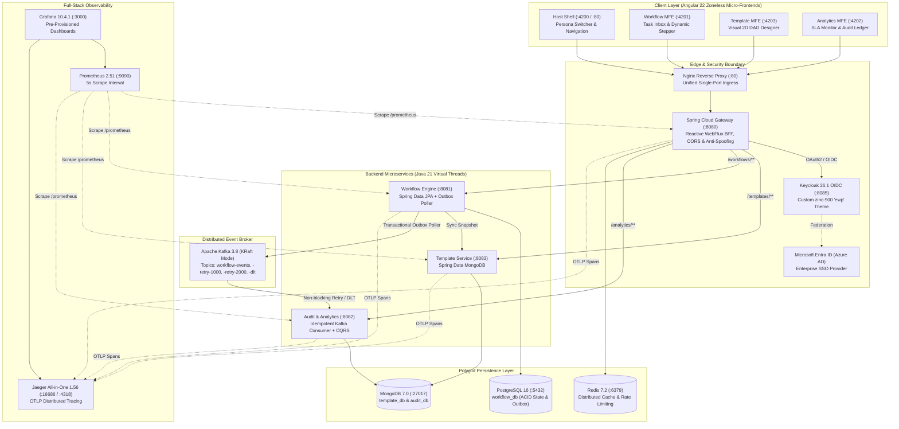

# Enterprise Event-Driven Workflow Platform

[](https://openjdk.org/projects/loom/)
[](https://spring.io/projects/spring-boot)
[](https://kafka.apache.org/)
[](https://angular.dev/)
[](https://www.keycloak.org/)
[](https://www.postgresql.org/)
[](https://www.mongodb.com/)
[](https://opentelemetry.io/)
[](https://github.com/ashishreddy-15/enterprise-workflow-platform/actions)

An enterprise-grade, event-driven microservices platform designed for high-concurrency business process automation, multi-tier approvals, dynamic form authoring, and immutable audit trails.

The platform is **100% data-driven** — state machines, required roles, dynamic form payload schemas, and transition paths are authored as versioned MongoDB templates, enabling new business workflows to be launched without writing or deploying new code.

---

## 📚 Master Documentation Hub

| Document | Primary Focus | Key Contents |
| :--- | :--- | :--- |
| [**Architecture Deep Dive (`docs/ARCHITECTURE.md`)**](file:///d:/ashish/enterprise-workflow-platform/docs/ARCHITECTURE.md) | System Design & Topology | C4 container model, Native Federation MFEs, Polyglot storage, Transactional Outbox, Kafka multi-topic retry, and Distributed Tracing. |
| [**REST API Reference (`docs/API_REFERENCE.md`)**](file:///d:/ashish/enterprise-workflow-platform/docs/API_REFERENCE.md) | Endpoint Specifications | Interactive Scalar explorer (`:8080/scalar`), Swagger endpoints, RFC 7807 problem details, request/response JSON schemas, and cURL commands. |
| [**Security & Identity Guide (`docs/SECURITY_GUIDE.md`)**](file:///d:/ashish/enterprise-workflow-platform/docs/SECURITY_GUIDE.md) | Zero-Trust & Identity | BFF pattern, HttpOnly SameSite cookie sessions, Sliding Session window, Keycloak 26 OIDC, Microsoft Entra ID (Azure AD), and RBAC personas. |
| [**Operations & Runbook (`docs/OPERATIONS_RUNBOOK.md`)**](file:///d:/ashish/enterprise-workflow-platform/docs/OPERATIONS_RUNBOOK.md) | Deployment & Ops | Single-command Docker Compose, hybrid local dev mode, port allocation matrix, Prometheus scraping, Grafana dashboards, Jaeger walkthrough, and disaster recovery. |
| [**Master Project Handbook (`docs/PROJECT_HANDBOOK.md`)**](file:///d:/ashish/enterprise-workflow-platform/docs/PROJECT_HANDBOOK.md) | Architectural Decisions | Elevator pitch, Stage Tracker (1–8), Architectural Decision Records (ADR-001 through ADR-014), and interview Q&A flashcards. |
| [**Implementation Roadmap (`docs/TODO.md`)**](file:///d:/ashish/enterprise-workflow-platform/docs/TODO.md) | Milestone Tracker | Comprehensive historical checklist of completed phases and upcoming roadmap (Testcontainers, SLA auto-escalation, Kubernetes manifests). |

---

## 🌟 Interactive API Console (Scalar)

Test and explore all platform APIs interactively in your browser with automatic schema validation, live execution, and code generators in 15+ languages:

👉 **URL**: **`http://localhost:8080/scalar`** (or **`http://localhost/scalar`** via Nginx)

---

## 🏗️ High-Level System Architecture



---

## ⚡ Core Distributed Systems Patterns

1. **Transactional Outbox Pattern**: Eliminates the distributed dual-write hazard between PostgreSQL and Apache Kafka. Workflow state updates and `outbox_events` are committed within a single local ACID transaction. A background poller relays pending events using `SELECT ... FOR UPDATE SKIP LOCKED` and a partial index (`WHERE status = 'PENDING'`).
2. **Polyglot Persistence**: Isolates transactional state (`PostgreSQL 16`) from flexible dynamic JSON schemas and high-throughput append-only audit logs (`MongoDB 7.0`) and sub-millisecond session caching (`Redis 7.2`).
3. **Data-Driven Dynamic State Machine**: Workflows are orchestrated based on template graphs defined in MongoDB rather than hardcoded logic. Steps configure actor scopes (`REQUESTER`, `ROLE`, `ANY`), required form keys, SLA hours, and transition targets.
4. **Frozen Template Snapshots**: When a workflow instance is initiated, a complete JSONB snapshot of the active template definition is frozen on the instance (`template_snapshot`). Publishing a new template version never breaks in-flight workflows.
5. **Optimistic Locking (`@Version`)**: JPA optimistic locking on `workflow_instances` prevents lost updates during concurrent approvals, failing fast with HTTP `409 Conflict`.
6. **Idempotent Consumer & CQRS**: The Kafka consumer uses `eventId` as MongoDB's primary key (`_id`), safely deduplicating at-least-once message deliveries. Write state in PostgreSQL is projected into MongoDB read models (`workflow_analytics_views`).
7. **Non-Blocking Multi-Topic Retries**: Failed Kafka messages route to `-retry-1000` (1s delay), then `-retry-2000` (2s delay), and finally to Dead-Letter Topic `workflow-events-dlt` without blocking partition throughput.
8. **BFF Security & Sliding Session Window**: Eliminates `localStorage` token theft by issuing signed HMAC-SHA256 JWTs in an `HttpOnly`, `SameSite=Lax` cookie (`ewp_access_token`) with a 60-minute idle inactivity timeout and an 8-hour absolute maximum lifespan.
9. **Native Federation Micro-Frontends**: Native browser ES module federation powered by Angular 22 Zoneless change detection (`provideZonelessChangeDetection()`), signals, and unified `ewp-theme.css` design tokens.
10. **Distributed Tracing (W3C TraceContext)**: OpenTelemetry SDK propagates standard `traceparent` headers across WebFlux reactive gateway calls, downstream Spring MVC endpoints, and Kafka message headers, rendering waterfall traces in Jaeger.

---

## 🚀 Quick Start (< 5 Minutes)

### Prerequisites
- Docker Engine & Docker Compose (`v26.0+`)
- Copy `.env.example` to `.env`:
  ```bash
  cp .env.example .env
  cp .env.example docker/.env
  ```

### Launch the Entire Platform
```bash
docker compose -f docker/docker-compose.full.yml up -d --build
```

### Access Points
| Interface | URL | Default Credentials | Description |
|---|---|---|---|
| **Platform Web UI** | `http://localhost:4200` or `http://localhost` | Select persona or SSO | Full Angular Shell + Micro-Frontends |
| **Interactive API Console** | `http://localhost:8080/scalar` | Public / Session Cookie | Scalar OpenAPI 3.1 Explorer |
| **Grafana Monitoring** | `http://localhost:3000` | `admin` / `admin` | Throughput, Latency, and JVM Virtual Threads |
| **Jaeger Distributed Tracing** | `http://localhost:16686` | Open Access | Waterfall trace visualizer |
| **Prometheus Targets** | `http://localhost:9090/targets` | Open Access | Time-series scraper metrics |
| **Keycloak IAM Console** | `http://localhost:8085` | `admin` / `admin` | OIDC Realm & User Management |

---

## 👥 Enterprise Personas & Demo Accounts

| Persona | User ID | Pre-Configured Roles | Authority & Scope |
|---|---|---|---|
| **System Administrator** | `admin.sys` | `ROLE_ADMIN`, `ROLE_MANAGER`, `ROLE_EMPLOYEE` | Blueprint Studio authoring, audit inspection, admin outbox replay. |
| **Legal Counsel** | `meera.legal` / `sarah.manager` | `ROLE_LEGAL_COUNSEL`, `ROLE_APPROVER` | Task Inbox: Review legal documentation, execute contract approval steps. |
| **Finance Director** | `rahul.finance` / `alex.finance` | `ROLE_FINANCE_DIRECTOR`, `ROLE_APPROVER` | Task Inbox: Review high-value Capex requests, verify budgets, approve procurement. |
| **Corporate Employee** | `ashish` / `david.employee` | `ROLE_EMPLOYEE`, `ROLE_SUBMITTER` | Initiation: Launch workflow instances, submit dynamic form payloads. |

---

## 💻 Tech Stack & Tooling

```
Backend:           Java 21 (Virtual Threads), Spring Boot 4.1.1, Spring Cloud 2025.1.3, Spring Data JPA,
                   Spring Data MongoDB, Spring Kafka, Spring Cloud Gateway WebFlux, Flyway, Spotless
Frontend:          Angular 22, Zoneless Change Detection, Signals, @angular-architects/native-federation,
                   Tailwind CSS v4, Inter & JetBrains Mono Fonts
Security:          Keycloak 26.1 OIDC, Microsoft Entra ID (Azure AD), BFF Pattern, HttpOnly SameSite Cookies
Databases:         PostgreSQL 16, MongoDB 7.0, Redis 7.2
Message Broker:    Apache Kafka 3.8 (KRaft Mode)
Observability:     Prometheus 2.51, Grafana 10.4.1, OpenTelemetry (OTel), Jaeger All-in-One 1.56
DevSecOps:         GitHub Actions, Gitleaks Secret Scanner, Aqua Trivy CVE Scanner, GitHub Container Registry (ghcr.io)
Containerization:  Multi-stage Docker builds, Alpine Linux JRE, Nginx 1.27
```

---

## 🧪 Local Hybrid Development Mode

Run databases and telemetry in Docker while running Spring Boot microservices and Angular dev servers locally in your IDE:

```bash
# 1. Start Backing Infrastructure (Postgres, Mongo, Redis, Kafka, Jaeger)
docker compose -f docker/docker-compose.infra.yml up -d

# 2. Launch Backend Microservices (Separate Terminals)
cd backend
mvn -pl template-service spring-boot:run        # Port 8083
mvn -pl workflow-service spring-boot:run        # Port 8081
mvn -pl audit-analytics-service spring-boot:run # Port 8082
mvn -pl api-gateway spring-boot:run             # Port 8080

# 3. Launch Frontend MFEs (Separate Terminals from frontend/)
cd frontend
npm run start:shell       # Port 4200
npm run start:workflow    # Port 4201
npm run start:analytics   # Port 4202
npm run start:template    # Port 4203
```

---

## 📄 License
This project is licensed under the [Apache License 2.0](LICENSE).
