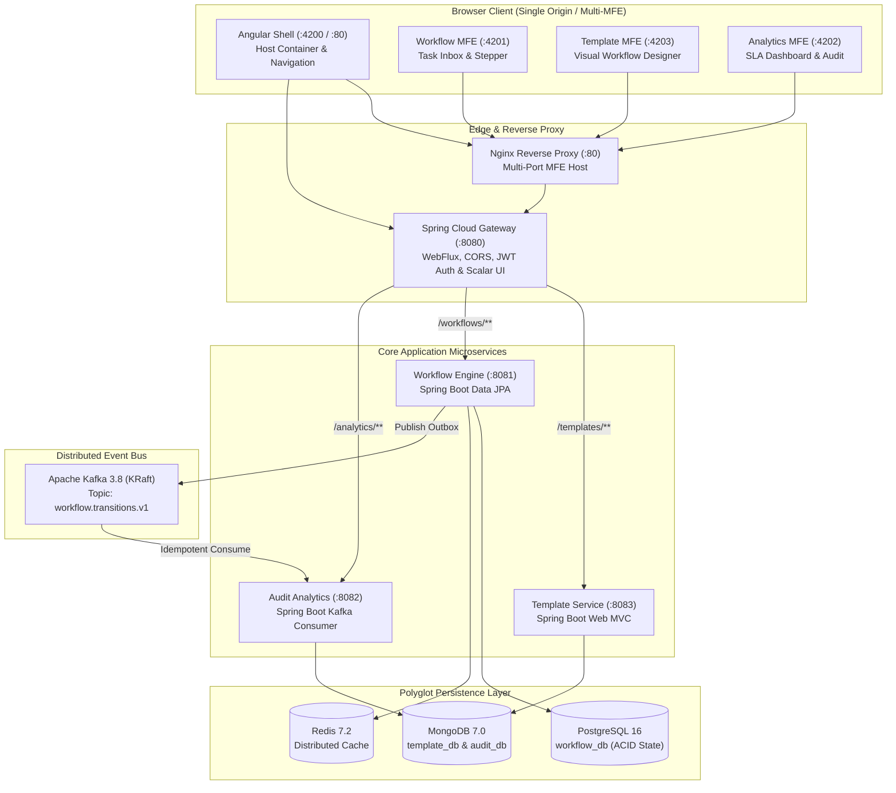
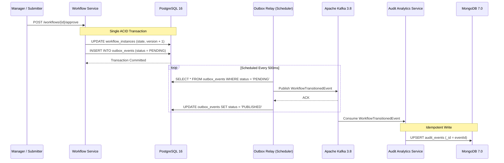

# Architecture Guide — Enterprise Event-Driven Workflow Platform

## 1. High-Level System Architecture

The platform is designed around the **Polyglot Microservices** and **Federated Micro-Frontends (MFE)** patterns, leveraging event-driven state transitions, distributed outbox patterns, and isolated domain storage.



---

## 2. Micro-Frontend Architecture (Native Federation)

The frontend is divided into independent micro-frontends orchestrated using **Native Federation** without Webpack or Module Federation runtime overhead:

```
frontend/
├── projects/
│   ├── shared-theme/         ← Single Source of Truth: ewp-theme.css & Tailwind @theme tokens
│   ├── shell/                ← Host container (Port 4200 / 80)
│   ├── workflow-mfe/         ← Remote: Task Inbox, approvals, stepper (Port 4201)
│   ├── analytics-mfe/        ← Remote: SLA monitoring & metrics (Port 4202)
│   └── template-mfe/         ← Remote: Visual workflow designer (Port 4203)
```

### Key Principles:
1. **Dynamic Manifest Resolution**: The Shell loads `federation.manifest.json` on initialization, resolving remote entry points dynamically at runtime without rebuilds.
2. **Resilient Error Boundaries**: If a remote MFE is unreachable, `MfeFallbackComponent` safely captures the error and displays a recovery banner rather than crashing the application.
3. **Cross-MFE State Synchronization**: Personas and authentication state are broadcast across MFEs using a zero-dependency `BroadcastChannel` with `localStorage` fallback via [`AuthBridge`](file:///d:/ashish/enterprise-workflow-platform/frontend/projects/shell/src/app/core/utils/auth-bridge.util.ts).
4. **Unified Design System**: All MFEs import [`ewp-theme.css`](file:///d:/ashish/enterprise-workflow-platform/frontend/projects/shared-theme/ewp-theme.css) at build-time, guaranteeing identical design tokens (`--color-ewp-primary`, typography, spacing) and semantic utility classes (`.ewp-card`, `.ewp-counter-pill`, `.ewp-task-item`).

---

## 3. Polyglot Persistence & Data Modeling

| Store | Technology | Purpose | Justification |
|---|---|---|---|
| **Workflow State** | PostgreSQL 16 | ACID approval tasks, state transitions | Strict transactional consistency, optimistic locking (`@Version`), and relational referential integrity. |
| **Outbox Events** | PostgreSQL 16 | Transactional Outbox pattern | Atomic writes within the same database transaction as workflow state updates. |
| **Workflow Blueprints** | MongoDB 7.0 | Dynamic step DAGs, JSON schemas | Schema-less document flexibility allowing arbitrary step definitions, transition rules, and input payload schemas. |
| **Audit Log** | MongoDB 7.0 | Immutable chronological audit trail | High-volume append-only write throughput with flexible query capabilities over event payloads. |
| **Distributed Cache** | Redis 7.2 | Template and active session caching | Ultra-low latency access for high-frequency reads. |

---

## 4. Transactional Outbox Pattern (Zero Message Loss)

When a workflow transitions or an approval is processed, writing to the database and sending a message to Kafka simultaneously creates a **Dual-Write Hazard**:



### Guarantees:
1. **At-Least-Once Delivery**: If the network or Kafka fails, the event remains `PENDING` in PostgreSQL and will be re-attempted on the next poll.
2. **Idempotent Consumption**: The Audit Service uses `eventId` as MongoDB's primary key (`_id`), safely dropping duplicate messages without corrupting audit logs.
