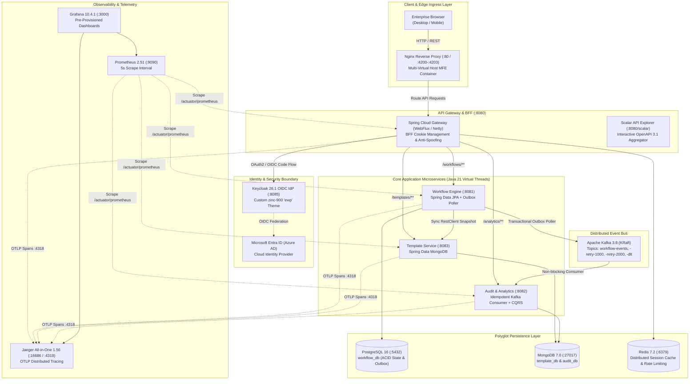
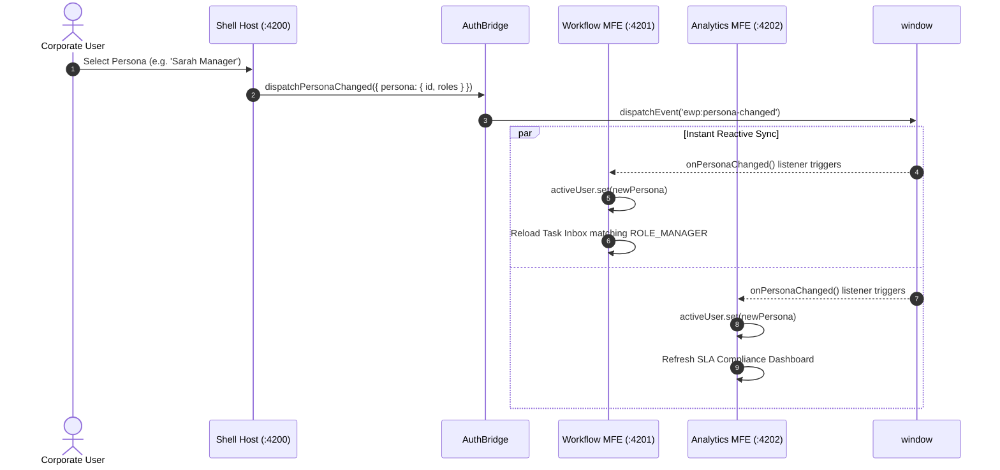
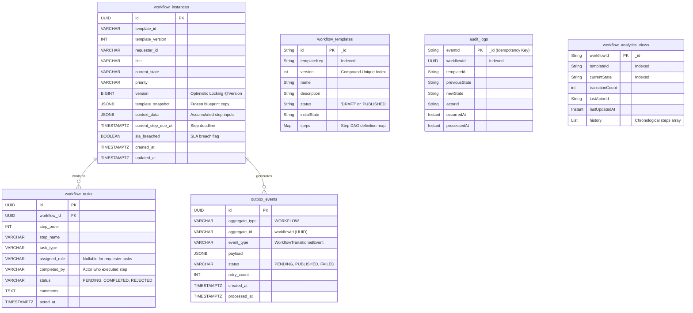
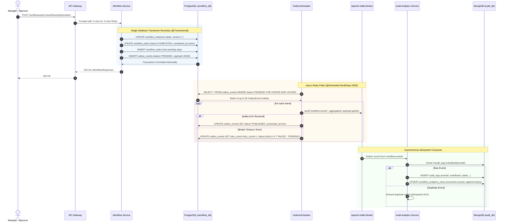
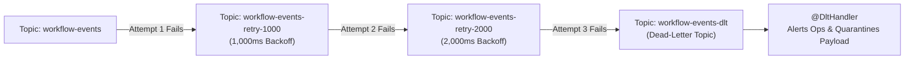
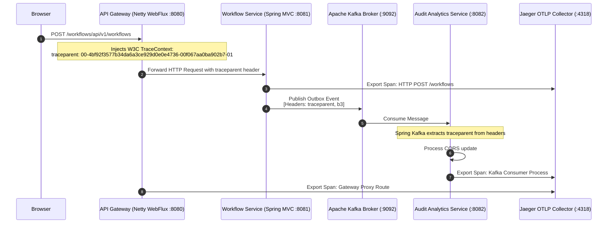
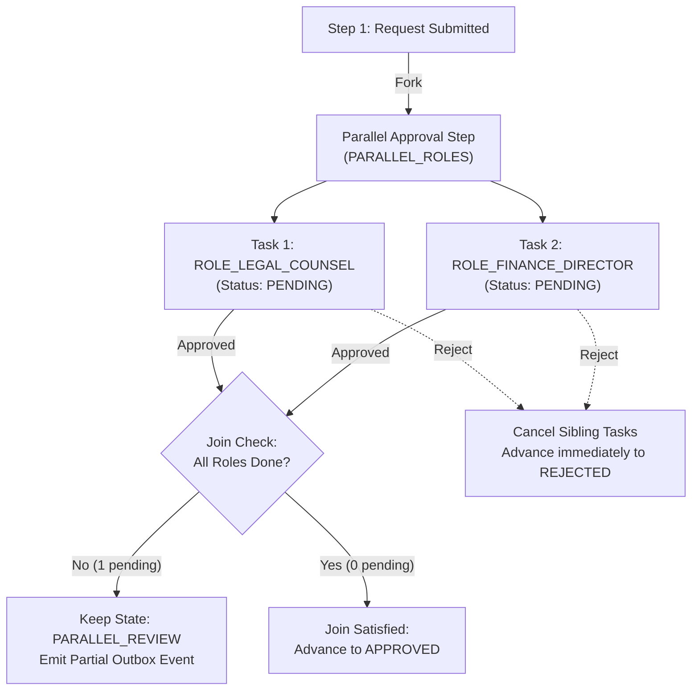

# Architecture Guide — Enterprise Event-Driven Workflow Platform

## 1. Executive Architecture Summary

The **Enterprise Event-Driven Workflow Platform (EWP)** is a cloud-native, distributed microservices system designed for high-concurrency business process automation, multi-tier approvals, dynamic form authoring, and immutable audit trails.

The platform is built on modern industry standards:
- **Runtime**: **Java 21 (Virtual Threads / Project Loom)** for high-throughput, non-blocking I/O.
- **Framework**: **Spring Boot 4.1.1** & **Spring Cloud 2025.1.3**.
- **Frontend**: **Angular 22** running **Zoneless change detection** with **Native Federation** Micro-Frontends.
- **Identity & Access**: **Keycloak 26.1 OIDC** federated with **Microsoft Entra ID (Azure AD)** and **Backend-For-Frontend (BFF)** `HttpOnly` cookie sessions.
- **Messaging**: **Apache Kafka 3.8 in KRaft mode** (no Zookeeper) with transactional outbox publishing and non-blocking multi-topic retries.
- **Persistence**: **Polyglot storage** (PostgreSQL 16 for ACID state, MongoDB 7.0 for flexible schemas and audit logs, Redis 7.2 for distributed caching).
- **Observability**: **Prometheus 2.51**, **Grafana 10.4.1**, and **OpenTelemetry (OTel)** distributed tracing with **Jaeger 1.56**.

---

## 2. High-Level System Architecture (C4 Container Diagram)



---

## 3. Micro-Frontend Architecture (Native Federation)

The client is divided into independent Micro-Frontends (MFEs) running **Angular 22** with **Native Federation** (`@angular-architects/native-federation`), avoiding Webpack and Module Federation runtime bloat by leveraging native browser ES Modules and `importmap`.

```
frontend/
├── projects/
│   ├── shared-theme/         ← Single Source of Truth: ewp-theme.css & Tailwind @theme tokens
│   ├── shell/                ← Host Container & Persona Navigator (Port 4200 / 80)
│   ├── workflow-mfe/         ← Remote: Task Inbox, approvals, stepper, execution modal (Port 4201)
│   ├── analytics-mfe/        ← Remote: SLA monitoring, bottleneck breakdown, audit ledger (Port 4202)
│   └── template-mfe/         ← Remote: Visual workflow & form designer, DAG validation (Port 4203)
```

### 3.1 Key Architectural Principles:
1. **Zoneless Change Detection**: All 4 MFEs use `provideZonelessChangeDetection()`, eliminating `zone.js` monkey-patching and achieving high rendering performance via Angular Signals.
2. **Dynamic Runtime Manifest**: The Shell initializes via `initFederation('federation.manifest.json')`, dynamically resolving remote entry points at runtime without rebuilding the host.
3. **Resilient Error Boundaries**: If a remote MFE is unreachable, `MfeFallbackComponent` captures the failure gracefully and displays an inline recovery banner rather than crashing the Shell.
4. **Cross-MFE State Synchronization (`AuthBridge`)**:
   - Zero-dependency event bus using standard `window.dispatchEvent(new CustomEvent('ewp:persona-changed'))` with `localStorage` fallback.
   - Persona switching in the Shell header propagates instantaneously across all mounted MFEs without page refreshes.
5. **Unified Design System (`ewp-theme.css`)**:
   - Built on Tailwind CSS v4 `@theme` design tokens.
   - Centralizes semantic class utilities (`.ewp-card`, `.ewp-btn`, `.ewp-badge`, `.ewp-input`, `.ewp-page-title`).



---

## 4. Polyglot Persistence & Data Modeling

The platform isolates domain data stores to match their operational characteristics:



### 4.1 Storage Selection Matrix

| Domain Store | Technology | Storage Schema | Justification |
|---|---|---|---|
| **Workflow State** | PostgreSQL 16 | Relational Tables (`workflow_instances`, `workflow_tasks`) | ACID compliance, multi-user concurrency control, optimistic locking (`@Version`), and complex relational filtering. |
| **Outbox Events** | PostgreSQL 16 | Relational Table (`outbox_events`) | Enables atomic database transactions combining state updates and event emission in a single commit. |
| **Workflow Templates** | MongoDB 7.0 | Document Collection (`workflow_templates`) | Schema-less flexibility for authoring arbitrary step graphs, form input schemas, and transition rules with compound uniqueness on `{templateKey, version}`. |
| **Audit Logs** | MongoDB 7.0 | Document Collection (`audit_logs`) | High-volume append-only audit trail with `eventId` serving as the immutable idempotency key. |
| **CQRS Read Views** | MongoDB 7.0 | Document Collection (`workflow_analytics_views`) | Denormalized, pre-joined read model optimized for instantaneous dashboard queries without expensive SQL joins. |
| **Distributed Cache** | Redis 7.2 | In-Memory Key-Value | Microsecond session token validation, sliding window expiration, and rate-limiting buckets. |

---

## 5. Event-Driven Architecture & Transactional Outbox Pattern

Simultaneously updating a database and publishing to an event broker creates a **Dual-Write Hazard**: if the broker is unreachable, the database commits while the event is lost; if the broker succeeds but the database fails, ghost events circulate.

The **Transactional Outbox Pattern** eliminates this failure mode:



### 5.1 Kafka Non-Blocking Multi-Topic Retry & DLT Strategy

Transient database or network errors in consumers must not block the entire partition. The platform implements Spring Kafka's `@RetryableTopic`:



---

## 6. Observability & Distributed Tracing Architecture

The platform implements unified telemetry across metrics, logs, and distributed tracing.



### 6.1 Telemetry Components:
1. **OpenTelemetry SDK & Micrometer Tracing**:
   - Integrated via `spring-boot-starter-opentelemetry`.
   - Exports spans via HTTP Protobuf to `http://jaeger:4318/v1/traces`.
   - Context propagation carries across reactive Netty boundaries (`Hooks.enableAutomaticContextPropagation()`) and asynchronous Kafka message headers.
2. **Jaeger All-in-One (`:16686`)**:
   - Visualizes end-to-end waterfall request spans correlating HTTP Gateway requests, database queries, outbox polling, and Kafka consumer processing under a single unified `traceId`.
3. **Prometheus Scraping (`:9090`)**:
   - Scrapes `/actuator/prometheus` across all microservices at 5-second intervals.
   - Monitors JVM Virtual Threads, GC pauses, HTTP throughput, and latency percentiles (p95/p99).
4. **Grafana Dashboards (`:3000`)**:
   - Pre-provisioned telemetry dashboards (`Platform Overview`) querying Prometheus and Jaeger datasources automatically upon startup.

---

## 7. Advanced Workflow Orchestration Engine

Beyond linear deterministic transitions, the platform supports enterprise-grade workflow orchestration:

### 7.1 Dynamic Conditional Branching (Rules Engine)

Workflows can route dynamically at runtime based on form payloads and context data using **Spring Expression Language (SpEL)**:

- **Sandboxed Evaluation Context**: Uses `SimpleEvaluationContext.forPropertyAccessors(DataBindingPropertyAccessor.forReadOnlyAccess(), new MapAccessor())`.
  - Disables method execution, Java class reflection, and OS process spawning (`ProcessBuilder`, `Runtime`).
  - Restricts operations exclusively to read-only property inspection and dictionary lookups.
- **Flexible Syntax**:
  - `#amount > 10000` or `amount > 10000`
  - `#payload['department'] == 'FINANCE'`
  - `#urgent == true && #amount > 50000`
- **Priority Evaluation & Determinism**:
  - Conditional rules are evaluated in ascending order of `priority`.
  - First matching condition determines the target state.
  - If no conditional rule matches, the engine falls back gracefully to the step's static `transitions` map.

### 7.2 Parallel / Multi-Party Approvals (Fork-Join)

Enterprise governance often demands dual or multi-sign-off steps (e.g., both Legal Counsel and Finance Director must sign off on a contract before onboarding):



1. **Fork (Task Generation)**:
   - When entering a step with multiple `requiredRoles`, the engine spawns an independent `WorkflowTask` for each role with status `PENDING`.
2. **Targeted Role Matching**:
   - When a user logs in, `TaskService` identifies the specific pending task matching the user's role.
   - Once signed off, the user's specific task transitions to `COMPLETED`.
3. **Join Barrier**:
   - The workflow state remains in the parallel step until all sibling tasks are completed.
   - An intermediate `WorkflowTransitionedEvent` is staged with `parallelJoinStatus = "PARTIAL"` to update audit ledgers and analytics without advancing the state machine prematurely.
4. **Fast-Fail Rejection**:
   - If any participant rejects, all other pending tasks for that step are marked `CANCELLED`, and the workflow advances immediately to the rejection target state.
5. **Segregation of Duties Enforcement**:
   - Requesters cannot approve their own requests on parallel steps, even if they hold one of the required approval roles.
