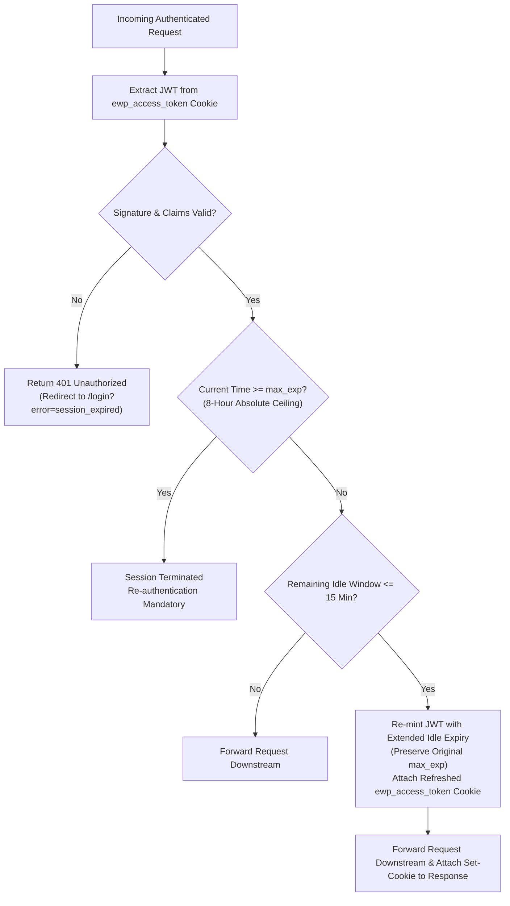

# Security Architecture & Identity Guide — Enterprise Workflow Platform

## 1. Executive Security Architecture

The Enterprise Workflow Platform adheres to zero-trust principles and implements the **Backend-For-Frontend (BFF)** security architecture, guaranteeing that raw access tokens and cryptographic credentials are never exposed to browser client-side JavaScript.

```mermaid
sequenceDiagram
    autonumber
    actor User as Enterprise User
    participant Browser as Angular Shell (:4200)
    participant Gateway as Spring Cloud Gateway (:8080)
    participant Keycloak as Keycloak 26.1 OIDC (:8085)
    participant EntraID as Microsoft Entra ID (Azure AD)
    participant Microservice as Downstream Service (:8081-:8083)

    alt Enterprise Single Sign-On (SSO) Flow
        User->>Browser: Click 'Sign in with Corporate Account'
        Browser->>Gateway: GET /oauth2/authorization/keycloak (or /azure)
        Gateway->>Keycloak: Redirect to OIDC Authorization Code Flow
        opt Entra ID Federation
            Keycloak->>EntraID: Federate to Microsoft Enterprise Login
            EntraID-->>Keycloak: OIDC Token Exchange
        end
        Keycloak-->>Gateway: Authorization Code
        Gateway->>Keycloak: Exchange Code for Access & ID Tokens
        Note over Gateway: OAuth2AuthenticationSuccessHandler extracts verified identity & roles
    else Developer / Simulation Persona Login
        User->>Browser: Select Persona (e.g. 'Sarah Manager')
        Browser->>Gateway: POST /auth/login { userId, roles }
        Note over Gateway: SessionTokenService mints signed HMAC-SHA256 JWT
    end

    Gateway-->>Browser: Set-Cookie: ewp_access_token=JWT; HttpOnly; SameSite=Lax; Path=/
    
    Browser->>Gateway: POST /workflows/api/v1/workflows (Cookie attached automatically)
    Note over Gateway: 1. CookieOrHeaderBearerTokenConverter validates signature & claims<br/>2. SlidingSessionWebFilter checks idle & max lifespan<br/>3. AuthenticationHeaderFilter strips client headers & injects verified claims
    Gateway->>Microservice: Forward Request with X-User-Id: sarah.manager, X-User-Roles: ROLE_MANAGER
    Microservice-->>Gateway: 200 OK
    Gateway-->>Browser: 200 OK (Updates Set-Cookie if session slid forward)
```

---

## 2. Why `localStorage` Was Eliminated (The BFF Pattern)

In legacy Single Page Applications (SPAs), JWT tokens are commonly persisted in `localStorage` or `sessionStorage`. This introduces severe vulnerabilities:

| Storage Model | XSS Vulnerability | CSRF Vulnerability | Production Enterprise Suitability |
|---|:---:|:---:|:---:|
| **`localStorage` / `sessionStorage`** | ❌ **Critical Risk** (Any cross-site script or compromised npm package can exfiltrate tokens) | ✅ Immune | ❌ **Rejected** (Violates enterprise security standards) |
| **In-Memory Only** | ✅ Protected from persistence | ✅ Immune | ⚠️ Degraded UX (Session lost on page refresh or tab open) |
| **`HttpOnly` + `SameSite=Lax` Cookie (Our Choice)** | ✅ **Protected** (JavaScript cannot read cookie bytes) | ✅ **Protected** (`SameSite=Lax` prevents cross-origin submission) | ✅ **Adopted Industry Standard** |

By configuring cookies with:
- **`HttpOnly = true`**: Browser restricts cookie access strictly to HTTP requests; `document.cookie` in JavaScript returns nothing.
- **`SameSite = "Lax"`**: Cookies are sent on same-site requests and top-level GET navigations, preventing Cross-Site Request Forgery (CSRF).
- **`Path = "/"`**: Cookie covers all platform paths through the unified Gateway and Nginx ingress.

---

## 3. Sliding Window Session Management

Implemented in `SessionTokenService.java` and enforced reactively via `SlidingSessionWebFilter.java`:



### 3.1 Dual-Timeout Mechanics:
1. **Idle Inactivity Timeout**: **60 minutes** (`SESSION_IDLE_TIMEOUT_MINUTES`). If a user abandons their computer for over an hour, the session expires automatically.
2. **Absolute Maximum Lifespan Ceiling**: **8 hours** (`SESSION_MAX_LIFESPAN_HOURS`). Stored as `max_exp` inside the JWT claims. Regardless of user activity, a session cannot slide indefinitely; after 8 continuous hours, re-authentication is strictly enforced.
3. **Proactive Sliding Renewal**: **15 minutes** (`SESSION_RENEW_THRESHOLD_MINUTES`). When an active user interacts with the platform and their idle window has $\le$ 15 minutes remaining, `SlidingSessionWebFilter` automatically re-mints a fresh token with an extended idle window while preserving the original `max_exp` ceiling.

---

## 4. Anti-Spoofing Identity Header Injection

To prevent malicious clients from attempting header spoofing attacks (e.g. sending forged `X-User-Id: admin.sys` or `X-User-Roles: ROLE_ADMIN`), the API Gateway employs [`AuthenticationHeaderFilter.java`](file:///d:/ashish/enterprise-workflow-platform/backend/api-gateway/src/main/java/com/ashish/workflow/gateway/config/AuthenticationHeaderFilter.java):

```java
// 1. Strip incoming client-supplied identity headers immediately
ServerHttpRequest sanitizedRequest = exchange.getRequest().mutate()
    .headers(httpHeaders -> {
        httpHeaders.remove("X-User-Id");
        httpHeaders.remove("X-User-Roles");
    })
    .build();

// 2. Extract cryptographically verified claims from the security context
String userId = resolveUserId(jwt);     // sub -> preferred_username -> oid
String roles = resolveRoles(jwt);       // roles -> realm_access.roles -> scope

// 3. Inject verified headers downstream to internal microservices
ServerHttpRequest downstreamRequest = sanitizedRequest.mutate()
    .header("X-User-Id", userId)
    .header("X-User-Roles", roles)
    .build();
```

Internal microservices inspect these headers via `UserHeaderInterceptor.java` and place them into `ThreadLocal<UserContext>`, guaranteeing downstream code operates on cryptographically verified identities.

---

## 5. Enterprise Identity Provider (Keycloak 26 & Azure AD)

### 5.1 Keycloak 26 Realm Architecture (`keycloak-realm.json`)
The platform runs Keycloak 26.1 in Docker Compose (`port 8085`):
- **Realm**: `ewp` (Display: `Enterprise Workflow Platform`).
- **Client**: `ewp-gateway` (Confidential client using Client Secret authentication).
- **Protocol Mappers**: Maps Keycloak realm roles directly into the JWT `roles` array claim.

### 5.2 Custom Keycloak Enterprise Login Theme (`ewp-theme`)
Located in `docker/keycloak-theme/`:
- Extends Keycloak v2 base theme with Inter typography.
- Styled to match the Angular platform's minimalist zinc-900 / white design system.
- Clean PatternFly v5 card container with focused outline rings and smooth transitions.

### 5.3 Microsoft Entra ID (Azure AD) OIDC Integration
Configured in `api-gateway/src/main/resources/application.yml`:
- Supports single-click corporate enterprise login via Microsoft OpenID Connect.
- Maps Azure tenant ID, client ID, and secret into Spring Security's reactive OAuth2 client registry.

---

## 6. Role-Based Access Control (RBAC) & Persona Matrix

The platform establishes 4 standardized enterprise security personas:

| Persona | User ID | Assigned Roles | Authority & Access Scope |
|---|---|---|---|
| **System Administrator** | `admin.sys` | `ROLE_ADMIN`, `ROLE_MANAGER`, `ROLE_EMPLOYEE` | Unrestricted: Author & publish workflow templates, inspect all audit logs, access admin outbox replay endpoints. |
| **Legal Counsel** | `meera.legal` / `sarah.manager` | `ROLE_LEGAL_COUNSEL`, `ROLE_APPROVER` | Task Inbox: Review legal documentation, execute contract approval steps, review NDAs. |
| **Finance Director** | `rahul.finance` / `alex.finance` | `ROLE_FINANCE_DIRECTOR`, `ROLE_APPROVER` | Task Inbox: Review high-value Capex requests, verify budgets, approve procurement POs. |
| **Corporate Employee** | `ashish` / `david.employee` | `ROLE_EMPLOYEE`, `ROLE_SUBMITTER` | Initiation: Launch workflow instances, submit dynamic form payloads, view own initiated tasks. |

### 6.1 Segregation of Duties (SoD) Enforcement
The core workflow engine enforces strict Segregation of Duties:
- A user who **initiated** a workflow instance is strictly prohibited from approving non-initial approval steps on that same workflow, even if they possess the required role.
- Prevents self-approval of financial expenditures and procurement dossiers.

---

## 7. DevSecOps & Automated Vulnerability Scanning

Integrated directly into GitHub Actions (`.github/workflows/security.yml`):

### 7.1 Gitleaks Secret Detection
- Audits full Git commit history on every push and pull request to ensure zero cryptographic secrets, passwords, or cloud tokens are committed.
- Governed by `.gitleaks.toml`, allowlisting non-sensitive sample files (`.env.example`).

### 7.2 Aqua Trivy CVE Scanner
- Runs filesystem vulnerability scans across dependencies and container images.
- Configured to fail on `CRITICAL` and `HIGH` CVEs with fixes available (`ignore-unfixed: true`).
- Scheduled weekly every Monday at 00:00 UTC.
