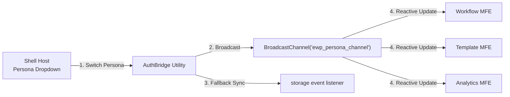

# Security Architecture & Authentication Guide

## 1. Executive Security Model

The Enterprise Workflow Platform employs the **Backend-For-Frontend (BFF)** security architecture, protecting authentication credentials against Cross-Site Scripting (XSS) and token exfiltration attacks.

```mermaid
sequenceDiagram
    participant Browser as Browser Client
    participant Gateway as API Gateway (:8080)
    participant Microservice as Downstream Service (e.g. :8081)

    Browser->>Gateway: POST /auth/dev-token (Select Persona)
    Note over Gateway: Sign HMAC-SHA256 JWT
    Gateway-->>Browser: Set-Cookie: ewp_access_token=JWT; HttpOnly; SameSite=Lax; Path=/
    
    Browser->>Gateway: GET /workflows/api/v1/tasks/inbox (Browser attaches cookie automatically)
    Note over Gateway: CookieOrHeaderBearerTokenConverter extracts JWT
    Note over Gateway: Validates signature & expiry
    Gateway->>Microservice: GET /workflows/api/v1/tasks/inbox<br/>Authorization: Bearer <verified-jwt>
    Microservice-->>Gateway: 200 OK Response
    Gateway-->>Browser: 200 OK Response
```

---

## 2. Why `localStorage` Was Eliminated

In legacy single-page applications, JWTs are commonly stored in `localStorage` or `sessionStorage`. This introduces severe vulnerabilities:

| Storage Location | XSS Vulnerability | CSRF Vulnerability | Production Suitability |
|---|:---:|:---:|:---:|
| `localStorage` / `sessionStorage` | ❌ **High Risk** (Any injected third-party JS script can read tokens) | ✅ Immune | ❌ **Unsafe for Enterprise** |
| In-Memory Only | ✅ Safe from XSS persistence | ✅ Immune | ⚠️ Lost on page refresh |
| **`HttpOnly` + `SameSite=Lax` Cookie (Our Choice)** | ✅ **Safe** (JavaScript cannot read cookie bytes) | ✅ **Protected** (`SameSite=Lax` prevents cross-origin requests) | ✅ **Enterprise Production Standard** |

---

## 3. Dual-Mode Token Extraction

The API Gateway supports both modern browser cookie sessions and automated external API clients via [`CookieOrHeaderBearerTokenConverter.java`](file:///d:/ashish/enterprise-workflow-platform/backend/api-gateway/src/main/java/com/ashish/workflow/gateway/config/CookieOrHeaderBearerTokenConverter.java):

```java
// 1. Check HttpOnly cookie first (Browser frontend)
HttpCookie cookie = exchange.getRequest().getCookies().getFirst("ewp_access_token");
if (cookie != null && !cookie.getValue().isBlank()) {
    return Mono.just(new BearerTokenAuthenticationToken(cookie.getValue()));
}

// 2. Fall back to standard Authorization: Bearer header (External APIs / Curl / Postman)
return serverBearerTokenAuthenticationConverter.convert(exchange);
```

---

## 4. Persona Matrix & Role-Based Access Control (RBAC)

The platform provides 4 enterprise personas for development, testing, and role simulation:

| Persona | User ID | Roles | Access Scope |
|---|---|---|---|
| **Admin** | `admin.sys` | `ROLE_ADMIN`, `ROLE_MANAGER`, `ROLE_EMPLOYEE` | Unrestricted: Author & publish blueprints, execute all tasks, view audit trails and SLA metrics. |
| **Manager** | `sarah.manager` | `ROLE_MANAGER`, `ROLE_APPROVER` | Task Inbox: Review, approve, and reject submitted workflows. |
| **Analyst** | `david.analyst` | `ROLE_ANALYST`, `ROLE_AUDITOR` | Read-only analytics: Inspect chronological timeline and evaluate SLA compliance. |
| **Submitter** | `alex.submitter` | `ROLE_EMPLOYEE`, `ROLE_SUBMITTER` | Initiation: Start new workflow instances and track own submissions. |

---

## 5. Cross-MFE Persona Synchronization (`AuthBridge`)

Because each micro-frontend is a separate bundle running on its own origin/port in dev mode, user persona switching must propagate instantly across all active views without requiring a hard page refresh:



---

## 6. Migration Blueprint: Moving to Production Keycloak / OIDC

When deploying to enterprise production with a real Identity Provider (Keycloak, Okta, Azure AD, PingIdentity):

1. **Disable Dev Token Minting**:
   In `application.yml` or container environment:
   ```yaml
   jwt:
     dev-token:
       enabled: false
   ```

2. **Configure OIDC Issuer URI**:
   Point Spring Security directly to your Keycloak realm:
   ```yaml
   spring:
     security:
       oauth2:
         resourceserver:
           jwt:
             issuer-uri: https://idp.company.com/realms/enterprise
   ```
   *Spring Security will automatically download the JWKS public keys from the IdP and validate all signatures without changing any downstream microservice code.*
